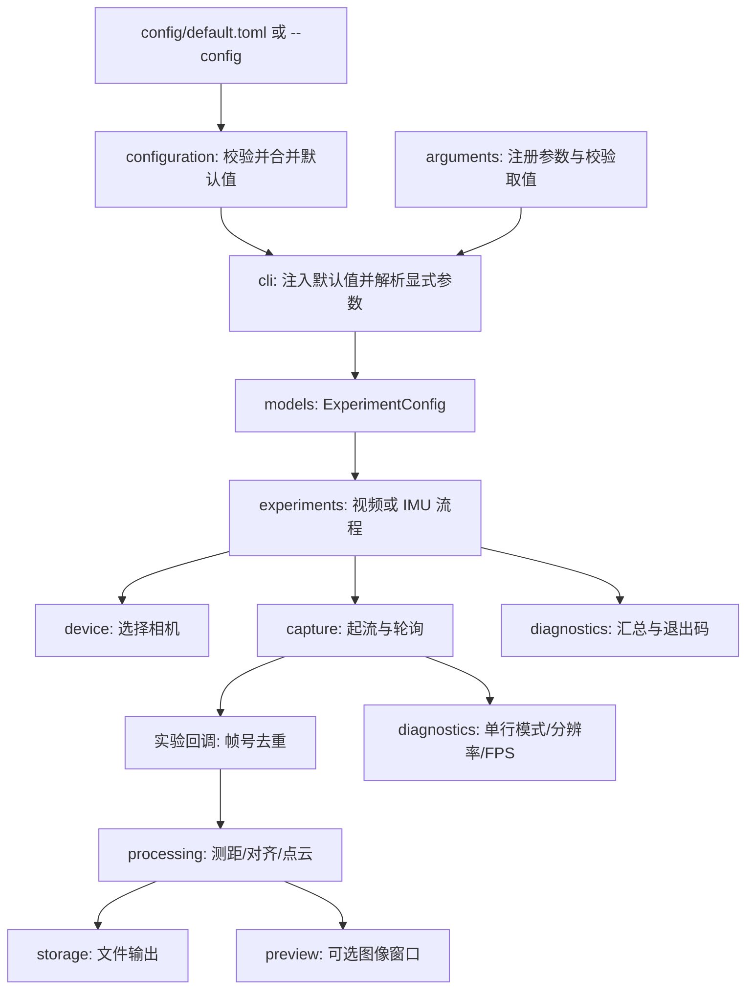

# 文档首页与项目架构

[项目首页](../README.md) · [安装](installation.md) · [CLI](reference/cli.md) · [配置](reference/config.md) · [排障](reference/errors.md) · [开发指南](../CONTRIBUTING.md)

## 阅读路线

| 你的目标 | 阅读顺序 |
| --- | --- |
| 第一次接入相机 | 安装 → CLI 的 `info` → 单流采集 → 排障 |
| 修改默认 FPS、分辨率或预览开关 | 配置 → CLI 的对应参数 → 开发指南的验证步骤 |
| 增加一个参数或算法 | 本页架构 → 开发指南 → 配置和 CLI 参考 |
| 直接在 Python 中复用 | 配置中的 Python 示例 → 本页的接口说明 |
| 判断测试是否正常 | CLI 的状态与结果 → 排障 |

## 目录职责

```text
camera-realsense/
├── README.md                 # 项目入口与最小使用示例
├── CONTRIBUTING.md           # 修改项目的操作指南
├── CHANGELOG.md              # 实现变化与历史验证
├── LICENSE                  # 当前许可证状态
├── pyproject.toml            # 依赖、命令入口、类型检查配置
├── uv.lock                   # 锁定依赖；通过 uv 更新
├── config/default.toml       # 所有 CLI 参数默认值
├── docs/                     # 安装与参考文档
├── src/camera_realsense/      # 主程序
├── tests/                    # 无实体相机的回归测试
├── typings/                  # pyrealsense2 类型声明
└── scripts/                  # 独立辅助脚本，不由主命令启动
```

本套文档描述 `uv run camera-realsense` 的实现。`scripts/` 中独立脚本拥有各自入口，
不会自动读取主程序的 TOML 或复用主程序的命令参数。

## 主程序模块

源码链接均相对于本页，可以直接跳转查看函数。

| 模块 | 主要接口 | 修改位置 |
| --- | --- | --- |
| [__init__.py](../src/camera_realsense/__init__.py) | 导出配置与结果类型 | 公共 Python API；导入包不会访问相机或读取配置 |
| [arguments.py](../src/camera_realsense/arguments.py) | `add_*_argument()`、类型校验函数 | 参数名称、帮助、取值类型和布尔开关 |
| [configuration.py](../src/camera_realsense/configuration.py) | `load_defaults()`、`convert_default()`、`apply_defaults()` | TOML 路径、字段校验、命令覆盖与默认值注入 |
| [cli.py](../src/camera_realsense/cli.py) | `build_parser()`、`to_experiment_config()`、`execute_command()`、`main()` | 组合参数、配置选择、命令分发与异常退出码 |
| [models.py](../src/camera_realsense/models.py) | `CaptureConfig`、`VideoConfig`、`OutputConfig`、`ExperimentConfig` | 共享配置与结果类型；`from_defaults()` 复用命令级默认值 |
| [device.py](../src/camera_realsense/device.py) | `select_device()`、`show_info()`、`read_calibration()`、`set_option()` | 设备、标定与传感器设置 |
| [capture.py](../src/camera_realsense/capture.py) | `configure_video()`、`configure_imu()`、`pipeline_session()`、`collect()` | 请求流参数、生命周期、去重后的统计与每路超时 |
| [processing.py](../src/camera_realsense/processing.py) | `measure_depth()`、`depth_image()`、`align_to_color()`、`cloud_arrays()` | 深度、图像、对齐与点云算法 |
| [storage.py](../src/camera_realsense/storage.py) | `save_images()`、`csv_output()`、`write_json()`、`write_ply()` | 路径、原始数据与输出格式 |
| [preview.py](../src/camera_realsense/preview.py) | `preview_session()`、`show_preview()`、`Preview` | 可选窗口、拼图和退出交互 |
| [diagnostics.py](../src/camera_realsense/diagnostics.py) | `display_capture_status()`、`summarize_video()`、`summarize_imu()` | 单行输出、实测 FPS 和 PASS / FAIL 判定 |

## 数据流



只有 CLI 层处理 `argparse.Namespace`。配置文件先校验，显式参数再覆盖对应默认值；
实验层接收配置对象，不处理命令行字符串。

视频回调在调用算法前按每路帧号去重。`collect()` 根据回调返回的流名集合累加统计，
以每路无新数据时间分别检测停帧，避免持续更新的深度流掩盖停止更新的彩色流。
这里的“完整帧组”指本次回调收到全部所需新流，不是时间戳完全相同或严格硬件同步保证。

`prepare_snapshot()` 把 SDK 帧复制为 NumPy 数组和元数据，存储模块不会打开相机。
录像例外：SDK 需要在起流前启用录制，所以 `capture.enable_recording()` 配置 pipeline，
`storage.prepare_recording()` 只校验路径。

## 配置和结果对象

| 类型 | 内容 |
| --- | --- |
| `CaptureConfig` | 时长、超时、帧数目标、预热和最低帧率比例 |
| `VideoConfig` | 主流和彩色流的分辨率/FPS、测距像素、可视化/点云距离上限 |
| `OutputConfig` | 文件路径、图片目录、预览开关 |
| `ExperimentConfig` | 命令、序列号、上述三组配置、流模式和彩色点云/IMU参数 |
| `CaptureStats` | 每路新帧数、完整组数、超时、无帧间隔、时长和停止原因 |
| `DepthMeasurement` | 像素位置、米制距离、深度单位和有效像素比例 |
| `ImageSnapshot` | 图像数组及元数据 |
| `VideoQuality` | 有效深度/对齐帧数、保存结果和最后一次图像诊断 |

配置 dataclass 是不可变对象。修改已有对象使用 `dataclasses.replace()`；
直接构造 `VideoConfig()` 使用 TOML 公共分组，`ExperimentConfig.from_defaults("depth")`
还应用深度命令的覆盖值。完整例子见 [配置参考](reference/config.md)。
